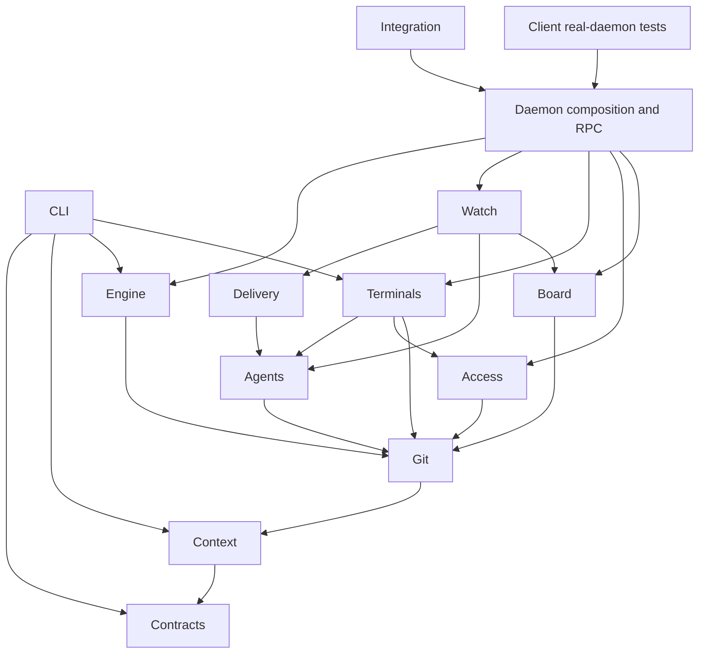

# ov-1219 — Split the daemon at ownership boundaries

Report-only spike, 15 November 2026. **Proceed with interface extraction, then the
engine and filesystem/git implementations. Do not start with a mechanical
redistribution of `Service` methods.** A split can remove unrelated daemon unit
tests from a narrow change's proposed coverage. It cannot remove real-daemon
consumer tests, and it offers little for core/protocol changes.

## Evidence and scope

Structural snapshot: `origin/main` / branch base
`73974f89898d716c36595eade2511ba5f8df7a8f`. Local `main` was behind at
`3f78754f936855710dfec920fe3d492f879b610d`; it is not the analysis baseline.
Locked, offline Cargo metadata, all features, no platform filter supplies the
current graph. [provenance.json](provenance.json) records the selector blob.

**Measured main source baseline, reused rather than rerun:**
`d986f3083730db7cda3b91caf5e536ba321b7c1e`, a verified ancestor of the structural
snapshot. The capture receipt names research-branch commit
`8a7ce8759c277bfe99bc6b5b30015c8a8b16f290`; that commit itself is not on main.
Its only differences from the main ancestor are report files. Validation checks
identical Git trees/blobs for crates, Cargo manifests/lockfile, .cargo, .config,
scripts and test inputs. Thus these are measurements of that main source, not
measurements of a divergent product implementation. The committed ov-1110 capture used an initially nonexistent target,
`cargo build --workspace --locked --offline --timings`, three build jobs, debug
info disabled, default host features, on this arm64 Mac. Its [raw receipt](../../../../reports/ov-1110/resume-local/results.json),
[Cargo HTML archive](../../../../reports/ov-1110/resume-local/cold-timing.zip),
[warm archive](../../../../reports/ov-1110/resume-local/warm-timing.zip), and
[logs](../../../../reports/ov-1110/resume-local/logs.zip) are the measurement sources.

Cold artifact build: **146.62 s** outer wall, exit 0. Warm unchanged build:
**2.00 s** outer wall, Cargo reports **0.31 s**, exit 0. Outer polling adds up to
2 s. Highest sampled load among all 1/5/15-minute averages: **9.33 cold, 8.66
warm**, under the required 20. This is not a cold download, release, Go-linked,
Linux or CI-runner benchmark. Timings overlap; per-crate compiler invocations
below must not be summed and described as observed build wall time.

No new build or product test suite ran for this report. A fresh timing capture
was queued under the shared heavy lock, then cancelled before acquiring it when
the existing controlled main evidence was verified. No other task was stopped.
The timing source is dated, not a measurement of today's exact main: 106 crate
files changed since it, +4,408/-983 lines. Daemon source grew from 165,480 to
167,406 lines; integration tests from 27,246 to 27,623. This makes the existing
capture a useful calibration, not an exact current edit-build prediction.

The same baseline's complete nextest capture supplies 6,928 test durations:
**700.841 s execution**, approximately **107 s harness compilation**, 811.51 s
outer wall, three test jobs, sampled load below 20. **6,916 passed and 12 failed**;
it is timing data, not a green gate or a verified green selector base. Do not use
this SHA to authorize skips. Repeated failure-summary lines are deduplicated by
nextest index. [test-weights.json](test-weights.json) preserves the aggregation.

## 1. Per-crate compilation and fan-out on main

[baseline.md](baseline.md) lists every workspace crate's measured compiler time
on the measured main ancestor and dependency fan-out on the current main
snapshot. [compile-units.json](compile-units.json) contains all raw Cargo units;
[crates.json](crates.json) includes the full dependency and consumer name lists.

Daemon currently owns **195,029 Rust lines** in src + tests (167,406 + 27,623),
plus 69 example lines. These are physical lines including inline tests and
comments, not production-only SLOC. The CLI is now 41,377 src + test lines and
store 39,227; the ticket's size ratio is approximate. Metadata finds **12 normal
workspace dependencies** for daemon, **14 unique normal/dev workspace
dependencies** and **15 graph dependencies** after ov-1116's CLI runtime edge.
All 12 apply on the Mac; ffi-guard is Mac-only, leaving 11 on Linux in this
unfiltered platform union. Count policy matters more than repeating the ticket's
older figure.

`farcooler-daemon`'s cold library invocation costs **16.82 s**, its executable
2.50 s and LFS filter 0.29 s. CLI costs 4.44 s. The larger optimization opportunity
is the tests hidden behind that one compilation unit, rather than its final
link. Client's dev-dependency on daemon and daemon's dev-dependency on client
form a permitted test cycle; CLI also imports the daemon as a normal dependency.
The selector additionally models CLI -> daemon as a runtime-consumer edge. A
leaf daemon edit presently selects daemon, client, CLI and JNI.

## 2. Proposed ownership, interfaces and dependency direction

All implementation packages are targeted at **10–30k physical Rust lines**, with
small contract/context crates deliberately exempt. Existing seams are the
starting ownership map, not a claim these files can already compile separately.
[modules.json](modules.json) assigns every daemon Rust file exactly once;
[module-edges.json](module-edges.json) counts lexical references crossing those
candidate boundaries. Lexical references include test code and may include
comments; they are a coupling checklist, not a compiler-resolved call graph.

| Proposed package suffix | Current owned lines | Existing seams / destination |
| --- | ---: | --- |
| `git` | 14,082 | git launch/sandbox/LFS/guard/exclude, fs_watch, change_set, file_diff, reconciliation, worktree files, stack, grep |
| `access` | 18,135 | people, enrollment, step-up, keys, authorization, sessions/tunnel admission, cutover/writer gates |
| `agents` | 22,331 | hook asks/ingress/install, Claude logins/registry, Codex trust, log joining/projectors, transcript tail, usage |
| `engine` | 16,203 | workflow_runtime and coding adapters, effect runner, workflow service/owner, drafts/summary, ticket moves, engine_stuck |
| `board` | 22,670 | tasks, needs_you, reps, review/landing/PR state, surveys/charters, plan reads |
| `service` | 27,477 | terminal/workspace lifecycle, launch, runtime, fanout, foreground, layout, push, paths, process helpers |
| `watch` | 14,104 | watch.rs loop, screen/marks cache, registry join, member/review pushes, watch view |
| `delivery` | 21,183 | watch/answer_wake and watch/task_notice, their submodules and local tests |
| existing daemon (composition/RPC) | 11,290 | rpc and wire, main/lib, remaining glue and binaries/examples |
| `integration` (test package) | 27,623 | all existing daemon tests/, with real daemon/CLI/client binaries |

The total is **195,098** including examples. Final sizes will shift as contracts
and context move out: target contracts 1–3k, context 1–2k, service approximately
24–27k and composition approximately 10–12k. Do not pad small interfaces to 10k.
Inline and adjacent module tests travel with their implementation; cross-domain
and transport scenarios stay in the integration package. Keep external client
real-daemon tests and JNI selection conservative.

The hard seams are visible today: 63 board files, 58 access files, 47 delivery
files and 23 engine files reference service; service references board in 21 files
and agents in 19. Access and RPC refer to each other in 32/45 files. Merely
introducing Cargo manifests would create cycles or recreate one giant crate.

**Contract layer:** `farcooler-daemon-contracts` owns domain DTOs, command/event
messages and narrow capabilities needed by RPC, CLI, watch and implementations.
Examples: terminal launch options/results, board read results, authenticated
caller and authorization verdicts, delivery requests, workflow inbox handle
interface. Preserve the workflow Controller/DecisionSession unforgeability:
never make capability constructors public or serializable to solve a dependency
cycle. Keep protobuf-generated messages in protocol, durable row ownership in
store, and pure engine definitions/reducers in the existing workflow crate.
No filesystem watcher, HTTP client, process spawning, concrete Service, Store
connection, or implementation re-export belongs in contracts.

**Context layer:** `farcooler-daemon-context` holds narrowly scoped access to the
existing Arc<Store>, tmux inventory, immutable runtime paths and clock/wake
handles. It may depend on store/tmux, but never on domain implementations.
It must not become another public bag of every implementation's mutable state.
Domain-owned state (login registry, sessions, engine owner) stays with its
owner, supplied via handles. Preserve the one durable Store authority and the
rule that live runtime state is derived from tmux, never persisted.

**Implementations:** split inherent `impl Service` blocks into owned domain
services or free functions over limited context. Rust cannot add inherent impls
for a type from another crate. Composition owns concrete services and injects
contracts into peers. Leave delegating methods/re-exports in daemon during each
migration so a slice can land independently; remove facade cycles before
claiming a build win. Watch calls contract handles rather than reaching back
into the aggregate Service. Delivery gets its own marks/input state and consumes
an activity snapshot; it cannot borrow Watcher's private fields indefinitely.

Desired dependencies, in addition to existing lower workspace crates:



Every implementation also consumes contracts/context as needed; these edges
are omitted visually. [proposal.json](proposal.json) specifies the complete
counterfactual selector graph, including lower crates, dev edges and the CLI
runtime edge. Runtime RPC wiring uses injected contract implementations, so RPC
dispatch does not put domain implementations back into a shared interface crate.
The CLI's current direct Runtime/foreground/workflow uses mean some
implementation edges remain (`service`, `engine` in the conservative model).
Migrate paths, quoting/opening prompts, layout parsing, report DTOs, rep verdicts
and landing-template types to their appropriate small API surfaces; do not move
all daemon utilities into core to make the CLI compile.

## 3. Five recent changes: before/after build + test minutes

The sample deliberately covers five observed change shapes, rather than five
handpicked successes. Full commit path lists and the **actual ov-1116
`select()` result** are in [selections.json](selections.json). Current source and
the proposed virtual metadata/path ownership both go through that same function.
These are per-commit changed-path scenarios against the pinned structural graph,
not historical CI replays or verified-green-base plans. Real `plan()` still
requires a clean tree and nearest verified successful main ancestor.

| Recent commit / shape | Before → after selected historical cases | Before build + test min | After build + test min | Total before → after min |
| --- | ---: | ---: | ---: | ---: |
| `6afab149a: engine test adjustment (ov-1085)` | 4,696 → 2,087 | 2.15 + 10.95 | 1.21 + 6.07 | 13.10 → 7.28 |
| `3c6cb253a: stuck-build notification + watch (ov-1077)` | 4,696 → 2,289 | 2.15 + 10.95 | 1.28 + 6.29 | 13.10 → 7.57 |
| `4d331fabd: workflow reducer/send-back (ov-1129)` | 6,694 → 6,694 | 2.53 + 11.67 | 2.72 + 11.67 | 14.20 → 14.38 |
| `2cf9644fc: core price update (ov-1092)` | 6,287 → 6,287 | 2.40 + 11.63 | 2.59 + 11.63 | 14.04 → 14.22 |
| `73974f898: engine + workflow + docs (ov-1148)` | 6,928 → 6,928 | 2.57 + 11.68 | 2.75 + 11.68 | 14.25 → 14.43 |

These are **planning estimates, not observed edit-build or post-split timings**.
The two narrow cases retain shell/integration/client/CLI tests and JNI selection;
they omit unrelated implementation-local tests only. The reducer example reaches
workflow -> protocol -> core and almost everything downstream. The pricing edit
still touches today's broad core crate. The final example falls back to full
coverage because it changes `docs/workspaces.md`; preserving that conservative
rule matters more than manufacturing a saving. Five scenarios are not a
frequency-weighted workload or an average developer-day forecast.

Reproducible arithmetic in [model.py](model.py), raw numbers in
[estimates.json](estimates.json):

- For each selected package set, sum historical per-case observed durations
  (`W`). Retain the failures' elapsed time. Scale measured execution wall by
  `W / 2091.409`: `T = 700.841 * W / 2091.409` seconds. Moving a test to a
  smaller crate does not make that test intrinsically faster.
- Product rebuild approximation is the **serial sum** of measured selected
  workspace compiler invocations with external dependency artifacts warm.
  Split the old 16.82 s daemon library invocation by the owned src-line share;
  retain its executable/filter cost in shell, and add 1 s per selected new
  implementation/contract/context package for fixed overhead. There is no
  measured post-split codegen, monomorphization or link time.
- Estimate harness compilation as `107 * W / 2091.409` seconds. Add this to
  product compilation and `T`. This is intentionally an allowance, not a
  separately measured marginal cost: test builds share product work, so the
  additive model can overcount; duration share is a weak proxy for test-build
  cost. Conversely, splitting can duplicate generic code and increase links.
- Sensitivity: use **0.5–2 times each modeled build component**, and
  **0.5–1.5 times each execution component**, giving roughly 6.5–20.7 minutes
  before vs 3.6–11.5 minutes after for the first narrow case. These are heuristic
  scenario bounds, not statistical confidence intervals. Serialized nextest
  groups, test ordering and real-daemon failures prevent translating summed
  per-case seconds into guaranteed replay wall savings. Old timing/test counts
  also exclude tests added after the capture.

The model deliberately keeps the existing client real-daemon dependency,
CLI runtime-consumer edge and all daemon integration scenarios. Its synthetic
metadata contains no cross-crate literal includes: moved tests must use explicit
test-support dependencies, and include/path consumers must be revalidated during
implementation. Module-local tests that still require the aggregate Service must
stay in integration, **not** add a dev-dependency back to daemon; that would
restore the cycle and invalidate these estimates. Package creation/manifests,
renames and fixture moves themselves trigger ov-1116 full fallback while landing.

**With today's shadow selector, actual required-gate test saving is zero.**
It always runs full coverage, then optionally replays selection, so the replay
can add time. The table estimates a later, separately authorized selected run,
conditional on sound inventory/consumer coverage. The split alone may improve
compilation reuse but does not change that policy. Full feature/target checks,
doctests, web, native apps, Go and nightlies remain; no full-gate minutes are
subtracted for them. Each extraction needs a fresh under-20-load cold/warm/edit
build and a full/selected inventory and replay comparison before a performance
claim, with the same wrappers. Never adopt the table as a skip decision.

## 4. High fan-in and costly dependencies

**Keep protocol small and stable.** It has 10 direct and 11 transitive consumers
in the selector graph, and every protocol source change is already a full
fallback. Its 3,348 handwritten src lines exclude generated OUT_DIR protobuf
output; its 5.04 s measured compilation includes generation/build scripts and
library work. Do not add daemon contracts, policy implementations or convenience
re-exports there. Preserve wire compatibility and existing proto checks.

**Stop growing core as a shared implementation bucket.** It is already 34,412
src lines, with 6 direct/7 transitive consumers; it is not small today. Keep stable
resource IDs, errors and minimal derivation vocabulary there. A follow-up can
separate agent session-log parsing/projectors/activity and model pricing from
resource interfaces. Do that with its own consumer inventory; it is outside this
daemon split and no savings from it are included above. In particular, moving
usage out of daemon will not by itself narrow a core pricing edit.

**Workflow also matters:** it has 12 transitive consumers because protocol
imports it. Keep its state/command schema stable and distinct from executable
coding adapters. Store is 39,227 lines and has 4 transitive consumers; keep
migrations and durable identity authoritative rather than distributing SQLite
access/migration ownership among new crates. New context/contracts packages must
remain low-churn: they are designed to acquire high fan-in.

Measured main compiler invocations identify dependency isolation candidates:

| Dependency | Measured seconds | Boundary / action |
| --- | ---: | --- |
| syn 2 / syn 3 | 12.37 / 11.53 | Distinct majors are not automatically replaceable. Keep full/visit syn in RPC-dispatch tests; moving those tests to the integration/RPC package avoids feature exposure across every new implementation. |
| serde_derive / clap_derive | 9.46 / 6.77 | Keep clap parsing in CLI. DTO derives in contracts; no blanket serialization derives on internal runtime ownership types. Serde still belongs where persisted state requires it. |
| prost-derive / prost-build | 5.69 / 4.49 | Generated wire and generator stay in protocol. Do not generate protobuf or include generated Rust separately in each extracted crate. |
| tokio / tracing attribute macros | tokio 6.17; tracing-attributes 5.69 | These are shared foundations; avoid adding macro features to tiny synchronous APIs just for convenience. Tokio's duration is its library, not solely macros. |
| thiserror-impl | 7.05 and 4.52 | Two resolved versions/units; keep local errors local, avoid a mega error enum that drags implementation types into contracts. |
| aws-lc-sys native build | 47.56 | Not a proc macro. Confine TLS/SSH dependencies to transport/client/push adapters. Splitting Rust modules cannot promise removing its cold-build critical path. |
| russh / reqwest | 9.45 / 6.50 | Put SSH/test transport and relay HTTP behind implementation boundaries, never in context/contracts. Existing cached builds already reuse these dependencies. |
| bundled libsqlite3-sys | 8.98 | Native SQLite compilation, not a derive cost. Keep store as its dependency owner. |

Proc-macro compiler time is distinct from execution of those macros inside
consumers; Cargo HTML does not separately measure the latter. Do not add the
numbers and call them a predicted saving. A cold workspace build still needs
most of these dependencies after the split. The benefit is containing their
features and downstream invalidation during ordinary edits.

## 5. Landable sequence

Each numbered item below is one PR unless explicitly expanded into a row per
slice. Keep behavior and wire output unchanged in all extraction PRs; keep old
public facade paths until callers migrate. A mechanical slice should move at
most about 5k lines plus its adjacent tests. The 10–30k destination size is an
end state, not permission to land a 30k-line move in one PR.

| PR | Concrete result | Validation before landing |
| --- | --- | --- |
| 1 | Record package/API/import inventory and add a dependency-direction check for the proposed layers; keep selector shadow-only. | Existing selector tests; prove a forbidden implementation -> daemon edge is rejected. |
| 2 | Introduce small contracts for launch inputs, board/report DTOs and caller capabilities. Move CLI's paths/quoting/template helpers to the appropriate stable API; preserve old exports. | CLI contract and parsing tests; wire fixtures/proto checks; full current daemon/client tests. |
| 3 | Introduce context with immutable paths, shared store/inventory and narrow handles; do not expose all Service fields. Extract independent fixtures that build context without daemon. | Store/terminal/bootstrap and shutdown tests; prove new package tests do not depend back on daemon. |
| 4 | Move git launch, sandbox, guard, exclude and LFS helpers (~4k) into git implementation; leave delegators. | Git sandbox/LFS tests on Mac/Linux; no executable naming changes. |
| 5 | Move fs_watch and backend modules (~4k) into that git package. | FSEvents/inotify tests and file-event groups; no test may reach the real home. |
| 6 | Move remaining diff/reconcile/stack/grep/worktree helpers (~6k, split into two <=5k PRs if diff exceeds budget). | Worktree transactions, lock/race and file diff tests; package graph/inventory. |
| 7 | Extract workflow inbox/capability contract and runtime owner from concrete Service, leaving daemon-owned startup/shutdown adapters. | Admission, forged-capability rejection, cancellation and owner join/restart tests. |
| 8 | Move engine's pure coding definitions and command adapters, with local fixtures (~4–5k). | Coding/verb/send-back/gate tests; full engine-vs-store consumer tests. |
| 9 | Move engine execution/native/build/review adapters (~4–5k). | Native PTY, bounded receipts, security and remote execution tests. |
| 10 | Move engine landing/fold/remainder and remove engine's facade dependency (~4–5k). | Landing conflict/rebase/group tests; fresh under-20 build timings and full/selected inventories. This is the first proposed saving checkpoint. |
| 11–15 | Access package in five individually landable slices: key/step-up primitives; enrollment/session admission; caller/people policy; access/cutover/writer mutations; remaining tests/facades. | Each slice's unit tests plus real SSH, revoke, person/access, migration/cutover and integration coverage. Preserve authority checks across awaits. |
| 16–20 | Agents in five slices: hook vocabulary adapters; ingress/asks; login/key registry; log/projector/tail; remaining trust/install/usage and tests. | Hook timeout/held-answer, log replay, login renewal, actual agent capture fixtures; no new live paid agent run just for moves. |
| 21–25 | Board in five slices: reads/DTOs; tasks/reps; review/PR state; landing/charters; notices/remaining tests. | Board invariants, stale revisions, PR reads, workflow exclusions; explicit handle-based cross-domain callbacks. |
| 26–31 | Terminal service/context/push in six <=5k slices: paths/process/push; launch/hooks; workspace/worktrees; terminal lifecycle; foreground/fanout; remaining ownership/facades. | CLI real-process paths, pane lifecycle, terminal I/O/backpressure, private runtime and teardown/leak checks. Keep CLI service/engine consumers until thin-client replacement is separately proven. |
| 32–36 | Delivery in five slices: route/queue; compose/park; interrupt/mid-turn; task notices; remaining tests/state boundary. | Existing held/queued/typing/resize/notice tests, using explicit context and delivery state rather than importing Watcher. |
| 37–39 | Watch in three slices: marks/screen/activity; registry/member state; loop/notices and remaining tests. | Timers/backstops, no-idle-work tests, Needs You and watcher failure cases; retained file-event test groups. |
| 40–45 | Move tests/ into integration package in six slices of existing binaries, <=5k each. Keep CARGO_BIN_EXE/binary discovery valid and test-support helpers explicit. Remove now-unneeded daemon dev edges only in the final slice. | Full inventory equality, real CLI/client planted-failure consumer test, preserve nextest groups and leak wrappers; transport/SSH restart tests. |
| 46 | Remove compatibility facades and stale CLI imports, remeasure cold/warm/edit/test and review selector artifacts. | Full Mac/Linux Rust gates, docs, all feature/target/doctest checks, JNI/web/native consumers affected by manifest changes. Require no missing test identities. Keep shadow-only policy. |

PR 6's budget exception means **6a/6b**, each its own PR; ranges above enumerate
individual PRs, not bundles to land together. Recompute mapping after each
checkpoint and stop extracting a boundary that cannot avoid a back-edge.
Prioritize PRs 1–10 first, then remeasure before committing to all 46+ steps.
If the engine split does not improve actual controlled edit/build/replay wall
time enough to offset migration cost, hold further splits. The smallest stable
API, independent test fixtures and consumer coverage are the acceptance gates;
line counts alone are not architecture.

## Reproduction and acceptance coverage

From this source snapshot (Python stdlib only; Cargo registry metadata cached):

```sh
python3 .claude/agent/reports/ov-1219/analyze.py
python3 .claude/agent/reports/ov-1219/model.py
python3 .claude/agent/reports/ov-1219/validate.py
python3 scripts/rust-shadow-test.py
```

`analyze.py` rejects product/selector/manifest drift from the pinned source.
`model.py` reads committed raw timings/test logs; neither command builds Rust,
runs product tests, changes selection policy or writes outside this report.
The virtual metadata has synthetic paths, no generated Cargo manifests or code
moves. Reproduction tests are model consistency checks, not correctness proof for
crates that do not exist yet.

Acceptance 1: measured per-crate Cargo timings on a verified main ancestor and
current main fan-out in baseline.md, with dating/load limits explicit.
Acceptance 2: every daemon file inventoried, 10–30k implementation boundaries,
separate contracts/context and cycle-breaking APIs above.
Acceptance 3: five recent real diffs, actual ov-1116 selection, reproducible
before/after minute estimates and uncertainty above.
Acceptance 4: core/protocol/workflow fan-in and macro/native isolation above.
Acceptance 5: ordered independently landable PRs with checks above.
Only this report directory changes; no product code moves and no cargo fmt.
