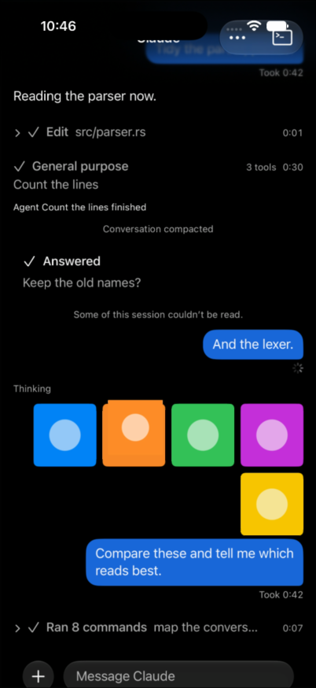

# ov-1097: the pan test needs vertical zoom room

## CI evidence

[Nightly 43303932801, phone6](https://github.com/taneliang/farcooler/actions/runs/43303932801/job/131507653767), November 12, ran on iPhone 17 / iOS 27.2. The complete execution log for `testASwipeDownClosesAnOpenImage` is preserved in [ci-test.log](ci-test.log):

- At 42.54 seconds, XCTest pinches with scale 3 in `QLPreviewControllerView`, using rect `{{50, 50}, {302, 774}}`.
- At 45.07 seconds, it starts a 300-point downward drag at 750 points/second.
- At 48.90 seconds, the viewer is gone; the test fails at line 434 with “a drag on the zoomed image closed it rather than panning”.

The retained test recording proves that the pinch **did** enlarge the picture. Its pale circle grows from 150 to 392 points in a 402 × 874 screen. The circle is half the fixture's height, so the enlarged image is still only about 784 points tall: it remains letterboxed, without vertical content to scroll. The next gesture is a dismissal flick, not a bounded pan within vertically overflowing content. Viewer existence alone did not establish the precondition the assertion depended on.

Frames from the recording, at 42.0, 44.4, and 45.2 seconds:

| Before pinch | After pinch | After flick |
| --- | --- | --- |
|  |  |  |

The shard was subsequently cancelled, but this test and the entire NativeAgentViewTests suite finished and reported their failures before cancellation. The uploaded xcresult lacks its final Info.plist. These frames come from its retained `kXCTAttachmentScreenRecording` payload (7,054,760 bytes), whose test summary identifies `NativeAgentViewTests/testASwipeDownClosesAnOpenImage()` and timestamp `2026-11-12T22:45:30.082+0000`. They are CI evidence, not local screenshots or a claim that the whole shard finished.

## Change

Wait for the fixture's pale orange circle to establish that the picture has decoded, excluding both white and black loading backgrounds. Use a larger pinch, then measure the circle in a screenshot. Require its height to exceed 70% of the screen, establishing vertical image content for the pan. Use a slow 80-point drag with a hold before release so the pan check does not fling the image into its edge. Keep the original 300-point fast dismissal swipe, and first verify that Quick Look's double tap returns the marker to its original fitted size. Preserve the existing before/after screenshot attachments.

The production Quick Look viewer is unchanged. The test continues to check short-drag cancellation, a drag while zoomed, dismissal while fitted, and return to the conversation.

## Validation

On the local iPhone 17 / iOS 27.0 simulator, using `scripts/ios-ui-tests.sh`:

- The unchanged test passed, confirming the failure is not reproduced by the old test on this runtime.
- With the larger zoom, the old pinch-in left the image zoomed and the final dismissal failed. Even scale 0.05 did not restore fitted size. Double tap plus the fitted-marker check passed.
- After rebuilding all simulator Rust XCFrameworks from the rebased source, the revised swipe test passed in the full class run (22.119 seconds).
- Rebuilt all simulator Rust XCFrameworks after rebasing before the final class/smoke run. The unrelated `testNoticeTurnsRenderAsNotices` fails both before and after that rebuild with “no notice turn”. Its unchanged harness emits `origin: Notification` without `notice`; the base's `NativeRows.swift` now requires `turn.notice == true`. This failure is outside image-swipe handling, and neither that harness nor its notice assertion is changed here.
- Full affected class plus `scripts/ios-ui-shards.py smoke`: 33 collected, 0 skipped, 32 passed, 1 failure (the notice test above). All smoke tests passed. See [local-validation.log](local-validation.log). The harness's `ClientCore.call` returns `standInCalls` directly, so rebuilding Rust cannot backfill the missing field in this Swift fixture.
- After tightening the initial decode guard to reject both white and black backgrounds, the final focused swipe test passed: 1 collected, 0 skipped, 1 actually ran. See [local-focused-test.log](local-focused-test.log).

The marker check rejects the failed CI precondition: 392 / 874 = 44.9%, below the required 70%. A passing **next nightly** remains a separate acceptance gate; local results cannot establish it.

## Follow-up validation, November 13

Re-read the ticket and the complete GitHub job log for nightly 43303932801, phone6. The [suite verdict excerpt](ci-suite-verdict.log) confirms that all 25 NativeAgentViewTests finished at 22:53:02 UTC, with this swipe test the sole failure. The later shard cancellation does not truncate this test's execution log or its class verdict.

The test now prints fitted-marker, zoomed-marker, and screen heights into the CI log, and retains the post-pinch screenshot before asserting the zoom precondition. Failed zoom or refit preconditions stop the test before the dependent gesture, so they cannot produce a misleading pan or dismissal failure. The optional recording flag is removed on early returns too.

Re-ran all four image methods on iPhone 17 / iOS 27.0: **4 collected, 0 skipped, 4 passed**. The fitted marker measured 452 pixels; after the pinch it measured 2,354 pixels on a 2,622-pixel screen, exceeding the 1,835-pixel threshold. After the recording-flag cleanup change, the final focused swipe run also passed: **1 collected, 0 skipped, 1 passed**. See [image-tests-validation.log](image-tests-validation.log).

Checked GitHub's latest five nightly runs during this follow-up. The newest remains 43303932801 at source commit `5ad68765332092f74bfee1364a89b0f86c1104c7`, before the zoom/drag correction. There is no subsequent nightly result for this fix yet; acceptance item 2 remains pending. The branch already contains the requested run-start base `9f6cbfb3926e54d8eedf8512e1ed3de331859ddf`.

## Final acceptance audit, November 13, 03:04 UTC

Read `farcooler task show ov-1097` again and fetched the full phone6 job log with `gh run view 43303932801 --repo taneliang/farcooler --job 131507653767 --log`. The retained test excerpt matches the fetched log: the scale-3 pinch is at 22:46:12 UTC, the 300-point / 750-point-per-second flick is at 22:46:15, and the pan assertion fails at 22:46:19. The class finishes at 22:53:02 with 25 tests and this sole failure. Re-inspected the post-pinch recording frame: the black band above the enlarged picture confirms the missing vertical-pan precondition described above. No further production or gesture changes are justified by this audit.

`gh run list --repo taneliang/farcooler --workflow nightly.yml --limit 5 --json databaseId,headSha,status,conclusion,createdAt` still reports 43303932801 as the newest nightly, created at 2026-11-12T20:48:24Z on `5ad68765332092f74bfee1364a89b0f86c1104c7`. There is no nightly running this branch's correction. The workflow normally runs on main; a local simulator result does not satisfy acceptance item 2.

| Acceptance item | Evidence / status |
| --- | --- |
| Cause named from a CI log | Confirmed: insufficient vertical zoom for the following fast dismissal-sized gesture; complete test execution and class verdict verified against the fetched job log and retained recording. |
| Test passes on the next nightly | **Pending external CI evidence.** No later nightly exists at the time of this audit. |

The local machine has iOS 26.5, 27.0, and 27.1 runtimes, but not CI's iOS 27.2. `git rebase "$FARCOOLER_BASE"` reports that `ov-1097-image-swipe-down` is up to date on the requested run-start base. Fresh local verification passed all four image methods: 4 collected, 0 skipped, 4 passed in 71.042 seconds. The swipe test measured a 452-pixel fitted marker and a 2,354-pixel zoomed marker on a 2,622-pixel screen (required greater than 1,835 pixels). See [final-image-tests-validation.log](final-image-tests-validation.log).
