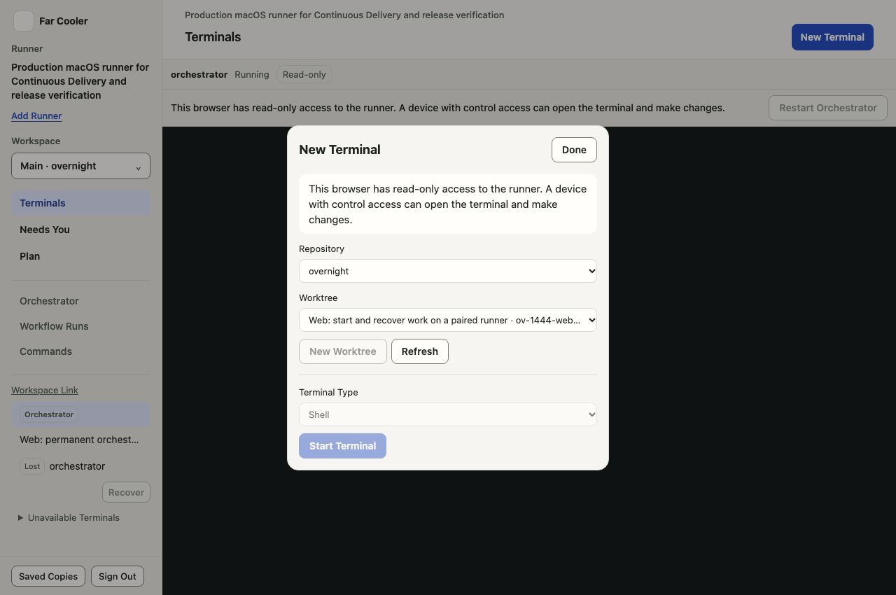
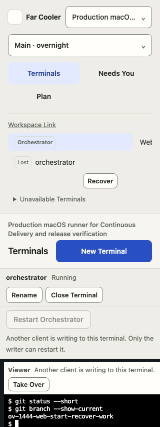

# ov-1491 · Web: create and restart terminals

## What was already there, and what was missing

The web could already open a shell, Codex or Claude Code in a chosen worktree. The button was labelled **Start Work**, so nobody looking for a new terminal found it. It's now **New Terminal**.

Missing, and added here:

- **Agent choices.** Terminal Type now lists Shell, Claude Code, Codex and Cursor, with the Mac app's models for each agent (**Default Model** first). An agent the runner didn't find reads **Not Installed** and can't be picked.
- **Restart in place.** An exited or failed terminal offers **Restart Terminal**. A lost one still offers **Recover Terminal**.
- **Restart Orchestrator**, for a running orchestrator after a confirmation, and for a stopped one.
- **Disabled with the reason** for a read-only browser, for a member the runner would refuse, and (while the orchestrator runs) for a viewer who isn't its writer.

## Where the rules live

The Rust work view (`crates/client/src/work_view.rs`) decides what's offered, what's off and why. The page draws it.

- **The runner says who may restart.** Only it knows whose login a pane runs on. Each listed terminal now carries `restart_refusal` (proto tag 51): the word the permission check would refuse this caller with, from the same code as the check. A runner from before this sends nothing, so the button is on and the runner still refuses with a message.
- **Agents and models** existed only in the Mac app's Swift (`Agents.all`). The core now has the list, and a test fails if the two differ. The Mac still reads its own.
- **The writer rule is new and lives in the web's core only.** The runner doesn't refuse a restart from a viewer. The Mac app has no such rule.

## A bug the real-runner walk found

Restarting a terminal that keeps its ID, such as the running orchestrator, removed its pane and attached nothing in its place. The page's layout looked unchanged, so it skipped the attach. The Work suite's stand-in page reattaches by itself and passed. The two-runner walk failed until `WorkspacePanes.forget` was fixed.

## Tests

The browser walk against two real Rust runners (`csp-check.mjs --workday-runner`) gained four scenarios. Keystrokes and restarts are read back through the runner's CLI.

| Scenario | Old page (`edf1f42fa`) | This branch |
| --- | --- | --- |
| Open a shell in a chosen worktree and type in it | passes (it could already) | passes |
| Restart a shell whose process exited | fails: no Restart Terminal | passes |
| Start Claude Code with Sonnet | fails: no Model choice | passes |
| Restart the running orchestrator, then type in it | fails: no Restart Orchestrator | passes |

Recovering a lost terminal shipped before this ticket, so its tests pass on both pages. It's walked on the real runners (the lost agent in the workday walk) and in the Work suite.

For the old page, a temporary copy of the walk looked for the old **Start Work** dialog name, so each scenario failed on its own control. Agents on these runners are the daemon's stub, so no real Claude or Codex ran.

Read-only and viewer states are shown by the Work browser suite (`work-check.mjs`, 29 passing). It uses the real Rust projection with a stand-in runner. The member refusal is shown there, in the core's tests, and in a runner test that compares each listed terminal's word with the permission check (`a_listed_terminal_says_whether_this_caller_may_restart_it`). No browser test signs in to a real runner as a member or read-only.

Also passing on this Mac: the `farcooler-client`, `farcooler-cli` and `farcooler-protocol` tests; the daemon's library tests matching people, rpc, wire, terminal, Claude login, lead change, reps and Needs You (501); `rpc_over_socket`; the web crate; the web unit tests; both TypeScript checks; the Board browser check; the fake-daemon security walk with a 100 ms tunnel delay; the split-pane sleep check; the canary size gate; and the shared-core, copy, file-size, doc-comment, daemon-layer, capability-name and proto lints. Clippy reported nothing in the touched files. The CLI and client tests need the agent pane's `FARCOOLER_*` variables cleared, or their hook tests fail.

Not run: CI, Linux, the stable bundle, the full daemon suite and the landing gate.

## Rechecked after the interrupted step

A runner restart interrupted the build step. After it resumed, these ran again on the same code and passed: the `farcooler-client`, `farcooler-protocol` and `farcooler-cli` tests; the daemon library tests under the filters above, and `rpc_over_socket`; both TypeScript checks; the web unit tests (263); the Work and Board browser suites; the canary bundle's size gate; the two-runner walk; and the shared-core, copy, doc-comment, daemon-layer, capability-name, file-size and proto lints. The old-page comparison was rebuilt from `edf1f42fa` with the same runner binaries and gave the table's result. The web crate tests, the fake-daemon walk, the sleep check and Clippy weren't run again.

The shell needs an arm64 Node first on `PATH`; the default one here is x86_64 and doesn't start.

## Captures

| | 320 | 1280 |
| --- | --- | --- |
| New Terminal |  |  |
| Exited, real runner |  |  |
| Orchestrator, real runner |  |  |
| Read-only |  |  |
| Member who doesn't lead |  |  |
| Viewer, not the writer |  |  |
