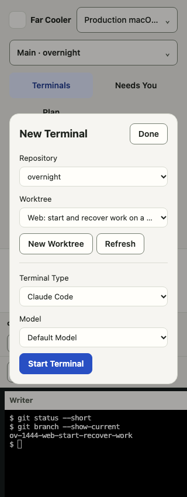
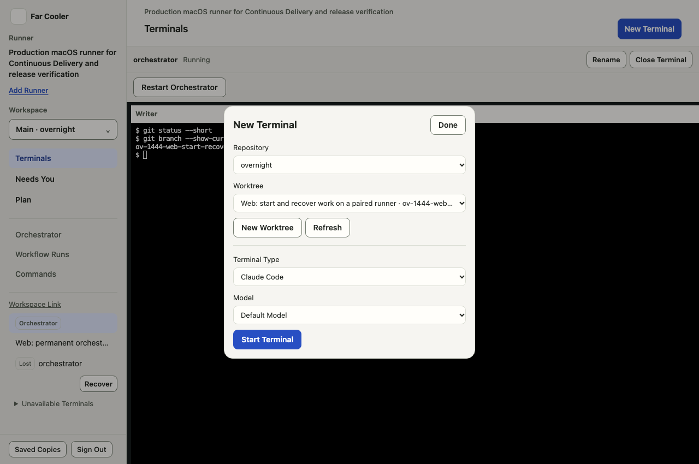
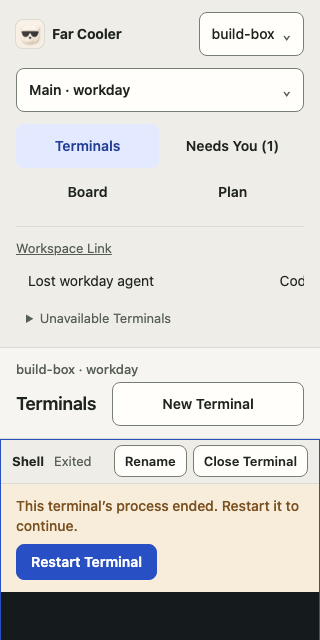
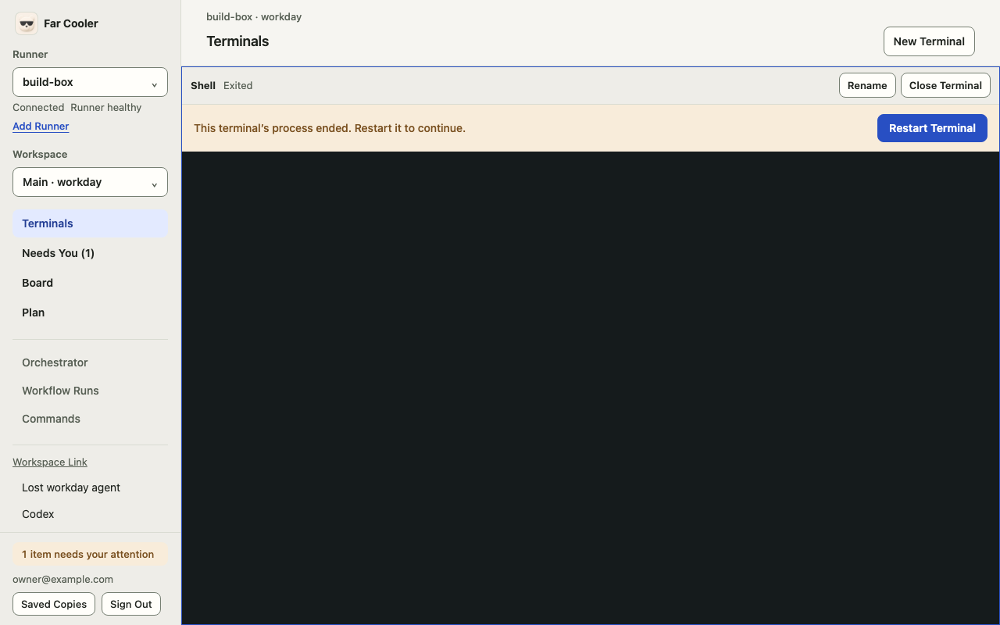
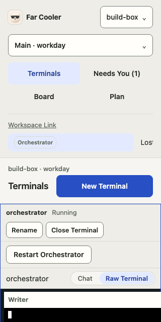
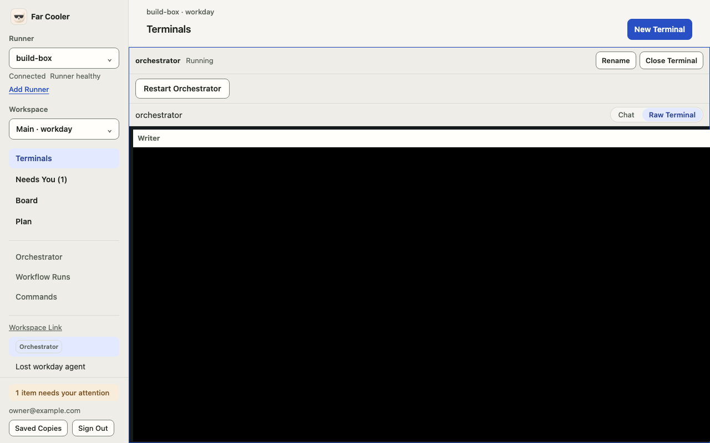
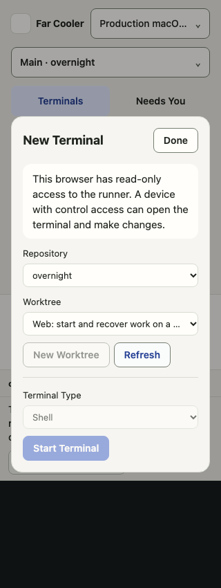
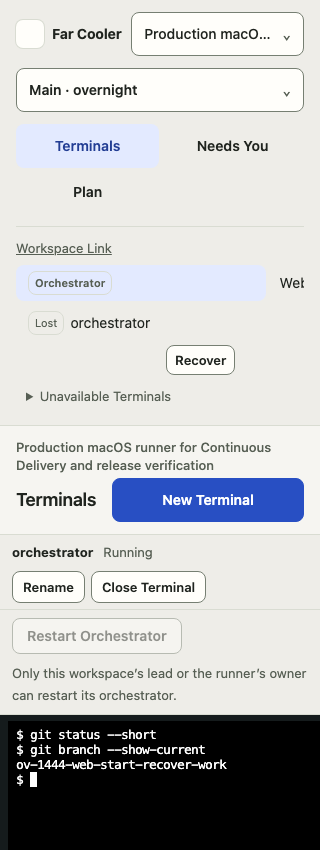
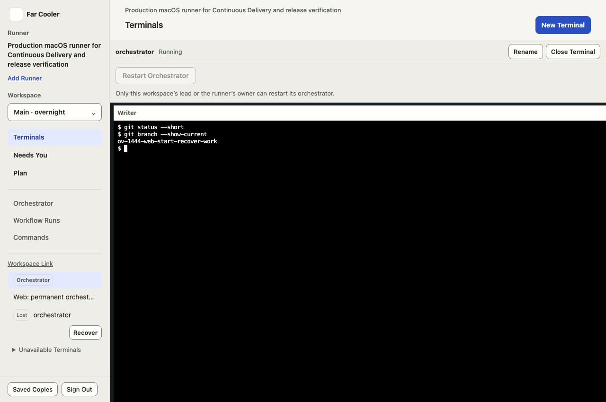
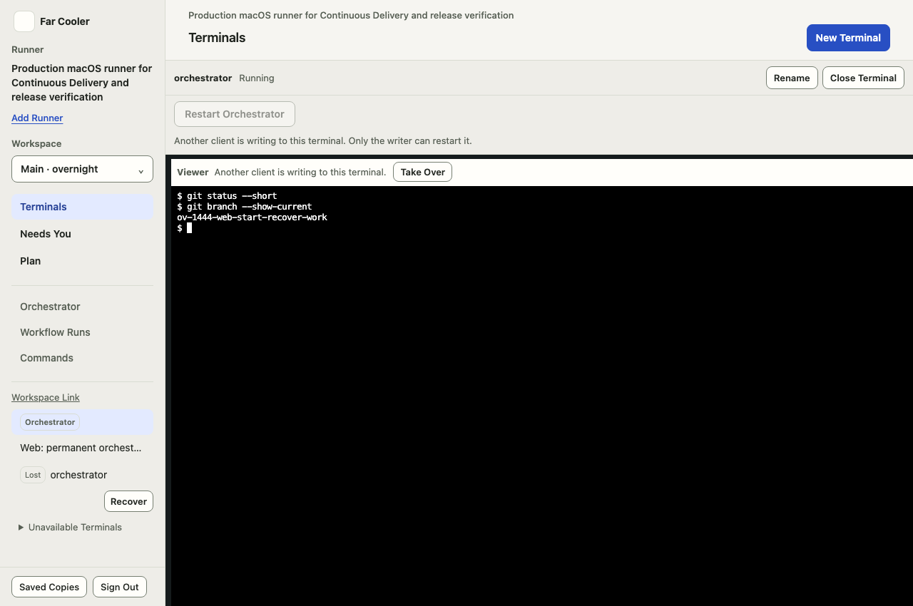

# ov-1491 · Web: create and restart terminals

## What was already there, and what was missing

The web could already open a shell, Codex or Claude Code in a chosen worktree. The button was labelled **Start Work**, so nobody looking for a new terminal found it. It's now **New Terminal**.

Missing, and added here:

- **Agent choices.** Terminal Type now lists Shell, Claude Code, Codex and Cursor, with the Mac app's models for each agent (**Default Model** first). An agent the runner didn't find reads **Not Installed** and can't be picked.
- **Restart in place.** An exited or failed terminal offers **Restart Terminal**. A lost one still offers **Recover Terminal**.
- **Restart Orchestrator**, for a running orchestrator after a confirmation, and for a stopped one.
- **Disabled with the reason** for a read-only browser, for a member the runner would refuse, and (while the orchestrator runs) for a viewer who isn't its writer.

## Where the rules live

The Rust work view (`crates/client/src/work_view.rs`) decides what's offered, what's off and why. The page draws it.

- **The runner says who may restart.** Only it knows whose login a pane runs on. Each listed terminal now carries `restart_refusal` (proto tag 51): the word the permission check would refuse this caller with, from the same code as the check. A runner from before this sends nothing, so the button is on and the runner still refuses with a message.
- **Agents and models** existed only in the Mac app's Swift (`Agents.all`). The core now has the list, and a test fails if the two differ. The Mac still reads its own.
- **The writer rule is new and lives in the web's core only.** The runner doesn't refuse a restart from a viewer. The Mac app has no such rule.

## A bug the real-runner walk found

Restarting a terminal that keeps its ID, such as the running orchestrator, removed its pane and attached nothing in its place. The page's layout looked unchanged, so it skipped the attach. The Work suite's stand-in page reattaches by itself and passed. The two-runner walk failed until `WorkspacePanes.forget` was fixed.

## Rebased onto `8d8a2f2b7`

The new base brought the React shell (ov-1510) and moved terminal input into the Rust core (ov-1499). Fitting these controls in changed four things:

- The pane's Recover button now sits in the shell's recovery strip, with the reason under it.
- A view has one filled button. A restart takes it from **New Terminal** only when it can be pressed and interrupts nothing. For a running orchestrator the strip matches the terminal header instead of looking like a warning. My first merge left it see-through over the dark terminal, which the captures showed. The Work suite now checks its color.
- Both branches had added a field called `watching` to `WorkspacePanes`. Git merged them cleanly, and TypeScript caught it. This branch's is now `viewing`.
- The Work suite's test page sent a pane's errors and the work view's note to one element, so this branch's redraw erased the base's "Keys … were not sent". The app uses two elements, and the test page now does too.

## The two-runner walk fails on the base

`csp-check.mjs --workday-runner` stops at line 1498: after the fixture opens a landing, the Plan never shows **Checking Here**. It shows only Backlog and To Do. The untouched base, built on its own, stops at the same line. This branch doesn't change the Plan, and I didn't fix it or look for the cause.

This ticket's four scenarios come after that step, so **the committed walk doesn't reach them until the base is fixed**. CI runs this walk. For the results below I removed the Plan landing step from a temporary copy. Everything else in the walk passed, with no CSP violations. The walk's "followed the runner's landing in Plan" log line still printed, but that part didn't run.

| Scenario | Base page (`8d8a2f2b7`) | This branch |
| --- | --- | --- |
| Open a shell in a chosen worktree and type in it | passes (it could already) | passes |
| Restart a shell whose process exited | fails: no Restart Terminal | passes |
| Start Claude Code with Sonnet | fails: no Model choice | passes |
| Restart the running orchestrator, then type in it | fails: no Restart Orchestrator | passes |

For the base page, the temporary copy also used the old **Start Work** dialog name, so each scenario failed on its own control. Both columns used this branch's runner binaries. Keystrokes and restarts are read back through the runner's CLI. Agents on these runners are the daemon's stub, so no real Claude or Codex ran.

Recovering a lost terminal shipped before this ticket, so its tests pass on both pages. It's walked on the real runners and in the Work suite.

## Tests

Read-only and viewer states are shown by the Work browser suite (`work-check.mjs`, 32 passing). It uses the real Rust projection with a stand-in runner. The member refusal is shown there, in the core's tests, and in a runner test (`a_listed_terminal_says_whether_this_caller_may_restart_it`). No browser test signs in to a real runner as a member or read-only.

Passing on this Mac after the rebase:

- the `farcooler-client`, `farcooler-cli` and `farcooler-protocol` tests (1303), the web crate tests, and `rpc_over_socket` (90);
- the daemon library tests matching people, rpc, wire, terminal, Claude login, lead change, reps and Needs You. Two database recovery tests failed in that run of 504 (the filter reaches them because "prepares" contains "reps"). All 15 recovery tests passed when run alone, and this branch doesn't touch that code;
- the web unit tests (268, and 50 for Needs You) and both TypeScript checks;
- the Work, Board, shell, chat and chat-files browser checks;
- the fake-runner walk with a 100 ms tunnel delay, the split-pane sleep check and the canary size gate;
- the shared-core, web client tree, copy, file-size, doc-comment, daemon-layer, capability-name and proto lints. Clippy reported nothing in the touched files.

Not run: CI, Linux, the stable bundle, the full daemon suite, the review browser check (it needs its own fixture) and the landing gate. The CLI and client tests need the agent pane's `FARCOOLER_*` variables cleared, and some client tests need `farcoolerd` built first.

## Captures

| | 320 | 1280 |
| --- | --- | --- |
| New Terminal |  |  |
| Exited, real runner |  |  |
| Orchestrator, real runner |  |  |
| Read-only |  |  |
| Member who doesn't lead |  |  |
| Viewer, not the writer |  |  |
