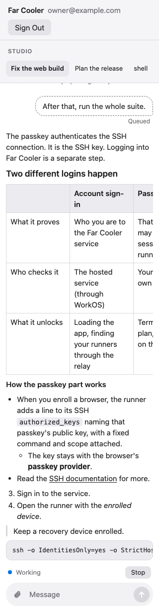
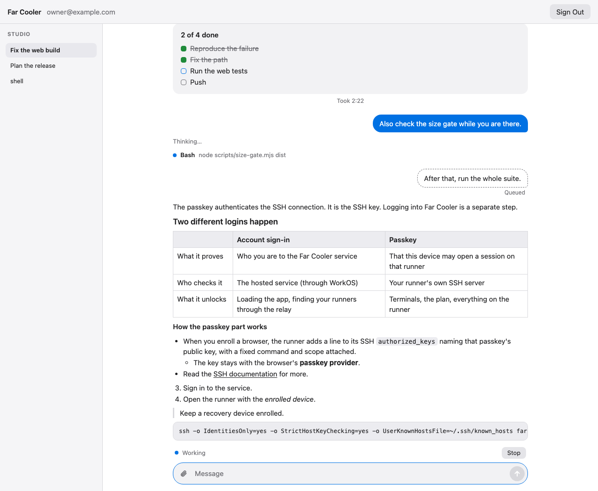

# ov-1493 Markdown in web chat

The regression fixture reproduces the passkey table from the owner’s screenshot, including its empty first header cell, and adds the other Markdown used in agent replies. The original web parser produced a paragraph with pipes and dashes. The browser check failed at both 320 px and 1280 px before the fix.

## Mac and web comparison

I ran the same fixture through the Mac’s Swift block parser and Foundation inline parser. They identified the three-column table, heading levels, nested bullet, list numbers 3 and 4, quote, fenced command, link, emphasis, and inline code. The web browser now renders each of those. The native table fits its pane by wrapping cells. The web table also wraps cells and adds horizontal scrolling when its columns exceed the message width. Fenced commands preserve line breaks and scroll horizontally within their code block.

Parsing lives in the web client. The shared Rust conversation core delivers prose as a string. The Mac implements Markdown in Swift AgentKit with Foundation for inline parsing, so there is no Rust Markdown parser for the web client to call. The web uses pinned `markdown-it` for CommonMark and pipe-table tokens, replacing the handwritten parser.

Raw HTML and scripts stay visible as literal text. The web renderer constructs DOM nodes from a fixed tag list and checks link protocol with the browser’s URL parser. It allows absolute HTTP, HTTPS, and mail links. Markdown image destinations display their alt text without fetching the URL. Tests cover literal HTML and script, mixed-case and entity-encoded `javascript:` links, and CSP violations. The production CSP is unchanged.

## Verification

- Chromium chat check passed, including total page width, local table scrolling at 320 px, header and cell alignment, cell wrapping, long code, and unsafe content. This check now runs in Web CI.
- Chat and header unit suites passed all 36 tests. Client TypeScript passed.

## Brotli budget

The production Canary size gate passed at **5,085,027 bytes** against the **5,500,000-byte** limit, leaving 414,973 bytes. The baseline was 5,048,563 bytes using the same production WASM assets. The parser and renderer increased the compressed client JavaScript from 159,445 to 195,667 bytes, a 36,222-byte increase. That cost covers CommonMark nested blocks, inline syntax, escaping, and pipe tables in one parser.

## Browser captures

The 320 px view shows the table at its left edge. The browser test also scrolls it to expose the rest of the Passkey column.

