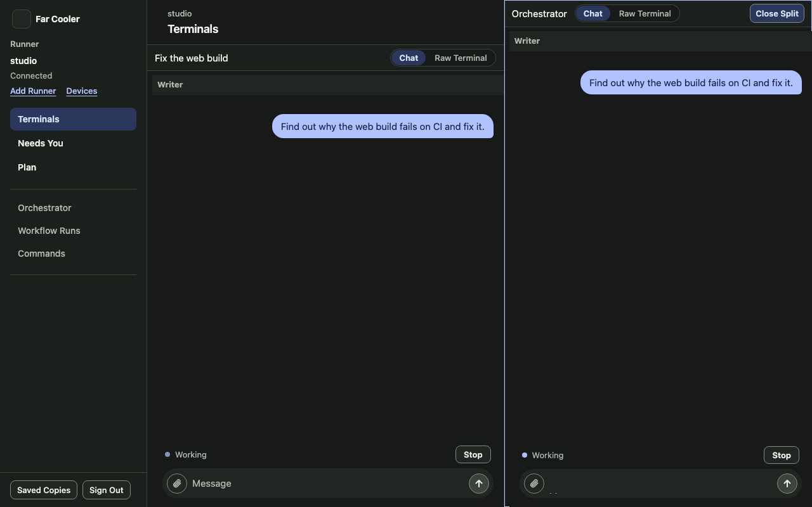
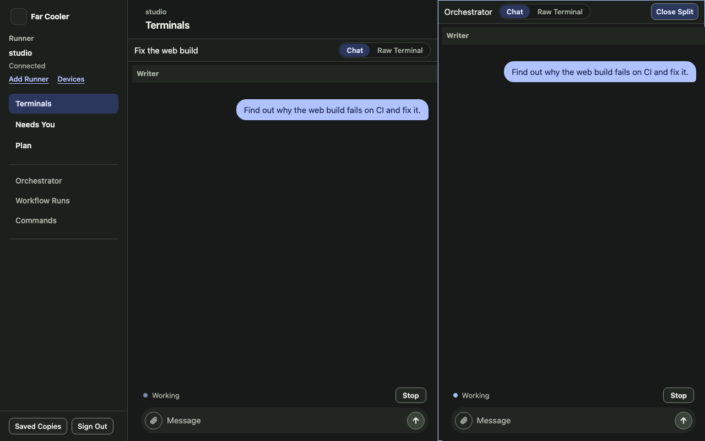
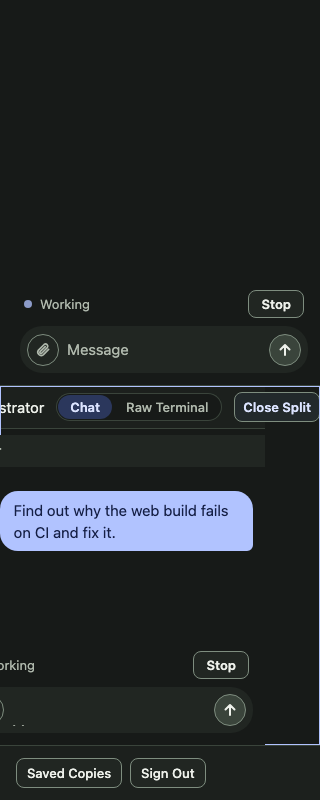
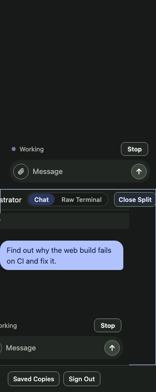
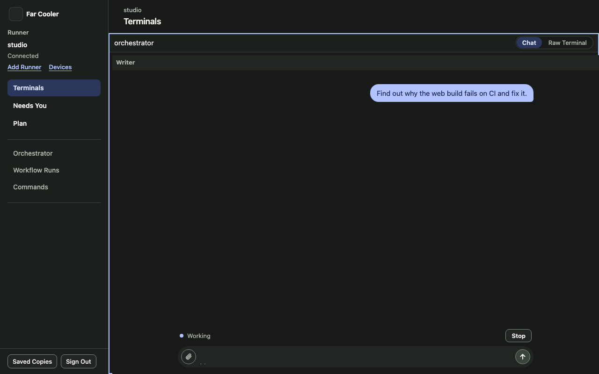
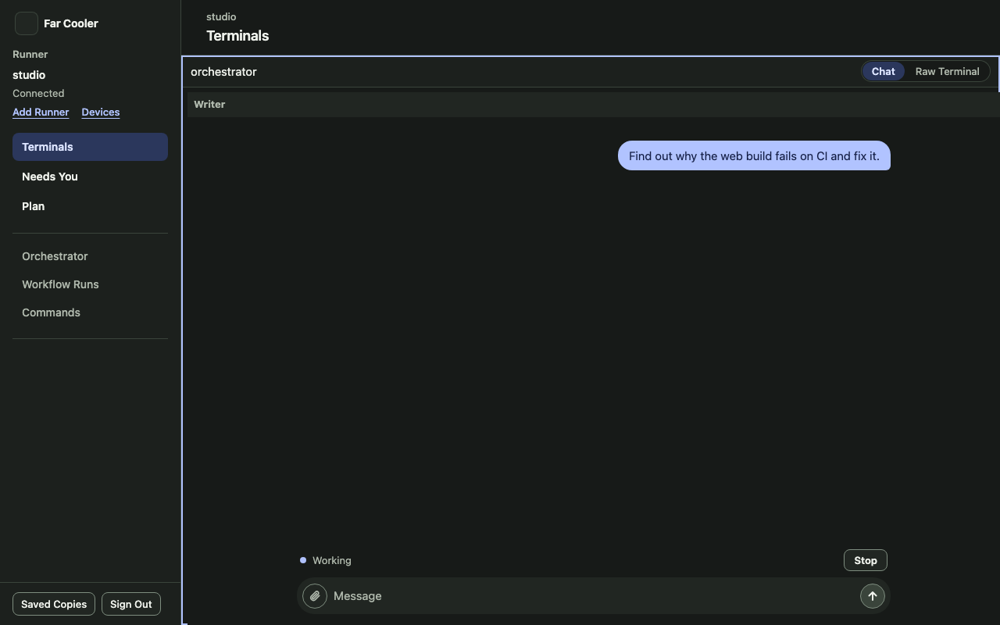
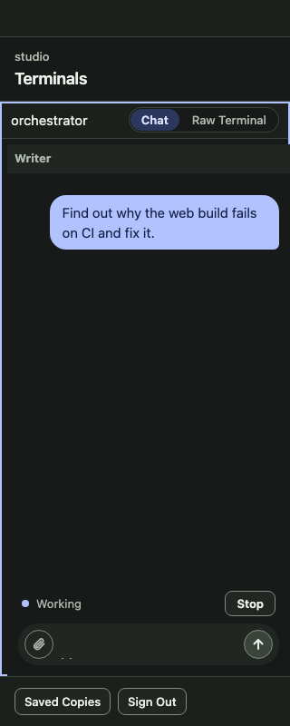
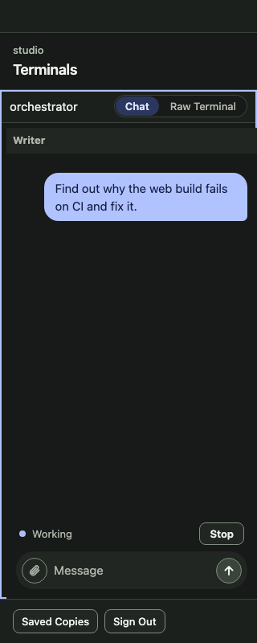

# ov-1495: the web message box after a split is closed and reopened

## Cause

**Element:** the chat composer's `<textarea class="chat-input">`.

`ChatView.sizeBox()` fits the box to its words by setting its height to its
`scrollHeight`. A textarea that isn't drawn reports a `scrollHeight` of 0, so
the box was given `height: 0px`. Only its 6 px of padding above and below
remained: **12 px where one line needs 33 px**.

The field around it stays 46 px tall, because the 32 px attach and send buttons
hold it open. The textarea sits at the bottom of that field and clips its
placeholder to the tops of the letters. Those are the two stray glyphs in the
owner's screenshot. No terminal text was drawn there.

It ran on an undrawn box in these cases:

- **A pane coming back.** `WorkspacePanes.render` calls `set.display(ids)`,
  which calls `ChatView.show(true)` and so `sizeBox()`. Only afterwards does
  `showWriters` unhide the pane's root. This covers a split closed and
  reopened, and switching to another terminal and back. A pane's first showing
  was unaffected, since a new root isn't hidden. So was a pane that only moved
  between the two sides.
- **A reply landing while the pane is away.** A successful send empties the box
  and sizes it again.

A related fault: nothing measured the box again when its width changed. A draft
that fit at 1280 px showed 75 px of its 117 px after narrowing to 320 px.

The agent working had no part in it.

## Did a Composer in That State Drop Sent Text?

**No message that reached the box was dropped. Typing could miss the box.**
This was measured on the unfixed code, through the real layout and a scripted
runner:

| What the person did | What happened |
| --- | --- |
| Clicked the field above the 12 px strip, typed, pressed Return | Focus went to the pane (`section#workspace-side`), not the box. The box stayed empty, nothing was sent, and no error showed. The keystrokes were lost. |
| Clicked the strip itself, typed, pressed Return | The first keystroke sized the box back to 33 px. The message was sent to the runner. |

Sending doesn't depend on the box's height: it reads the box's value, and the
box wasn't read-only.

**For ov-1494:** this is unlikely to explain a *sent* message that got no
response. In the failing case, no words ever appear in the box, and nothing
becomes a message. It could explain "I typed and nothing happened". The check
used a scripted runner, so it says nothing about delivery past `compose`.

## Fix

All in `services/web/src/client/chat.ts`:

- `sizeBox()` no longer keeps a measurement of 0. An undrawn box stays at its
  natural one row.
- A `ResizeObserver` on the conversation's host sizes the box again, and keeps
  the scroll position at the bottom, when the pane is drawn again or changes
  size. It watches the host, so sizing the box doesn't trigger it again.

Fixing it here covers every caller, whatever order the page shows things in.
`workspace-panes.ts` is unchanged.

## Test

`services/web/test/browser/split-check.mjs` runs the real `WorkspaceLayout`
(with the Rust layout policy), `WorkspacePanes` and `ChatView` in Chromium. Only
the runner is scripted. For the box, it checks that it is at least one line
tall, has the placeholder "Message", takes focus from a click in the middle of
the field, takes typed text and sends it to the right terminal. It runs in CI
after `chat-files-check`.

| Case | Before | After |
| --- | --- | --- |
| Split closed and reopened, 1280 and 320 | Fail: 12 px | Pass |
| Another terminal and back, 1280 and 320 | Fail: 12 px | Pass |
| Draft across narrow, wide, close and reopen | Fail: 75 of 117 px | Pass |
| Reply landing while the pane is away | Fail: 12 px | Pass |

"Before" is this branch's test against `chat.ts` as of `8cb725fe9`.

Also run and passing: `chat-check`, `chat-files-check`, `shell-check`, the chat,
panes, agent pane and attachment unit tests (62), the client type check, and
`lane-gate.py --self-test`. Not run: the other browser checks, WebKit, Firefox
and a real runner.

## Captures

These come from the test page with a scripted runner. The runner's name and
icon are placeholders. At 320 px the page is scrolled so the box is in view.

| | Before | After |
| --- | --- | --- |
| Split reopened, 1280 |  |  |
| Split reopened, 320 |  |  |
| Switched back, 1280 |  |  |
| Switched back, 320 |  |  |

## Seen, Not Changed

At 320 px wide and 800 px tall, the page header leaves the lower part of the
pane, including the message box, below the window. The existing `shell-check`
page measures the same way (`#work` starts at 437 px and is 577 px tall). The
test scrolls the box into view first. Whether a finger can scroll there on a
phone wasn't checked.
