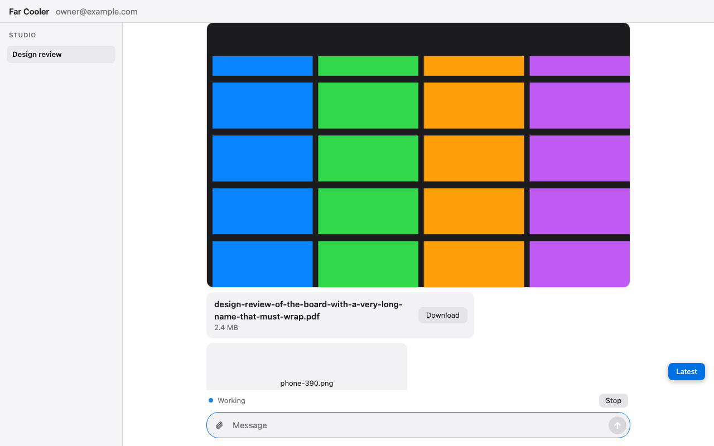
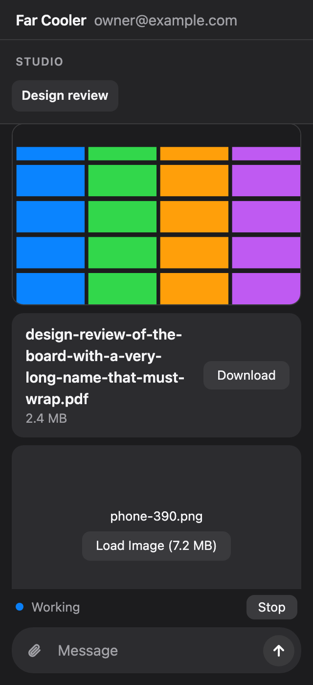
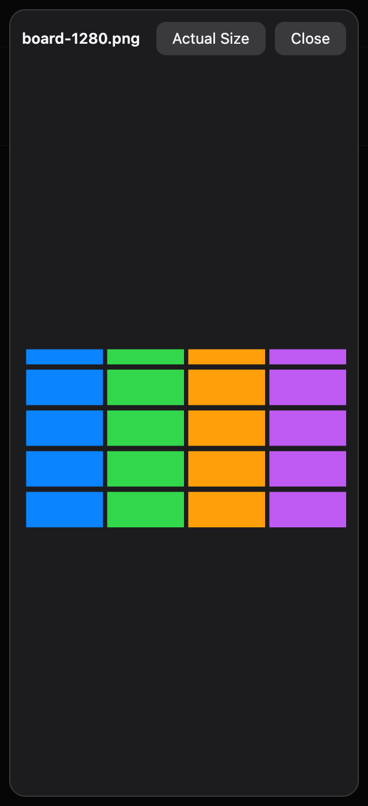
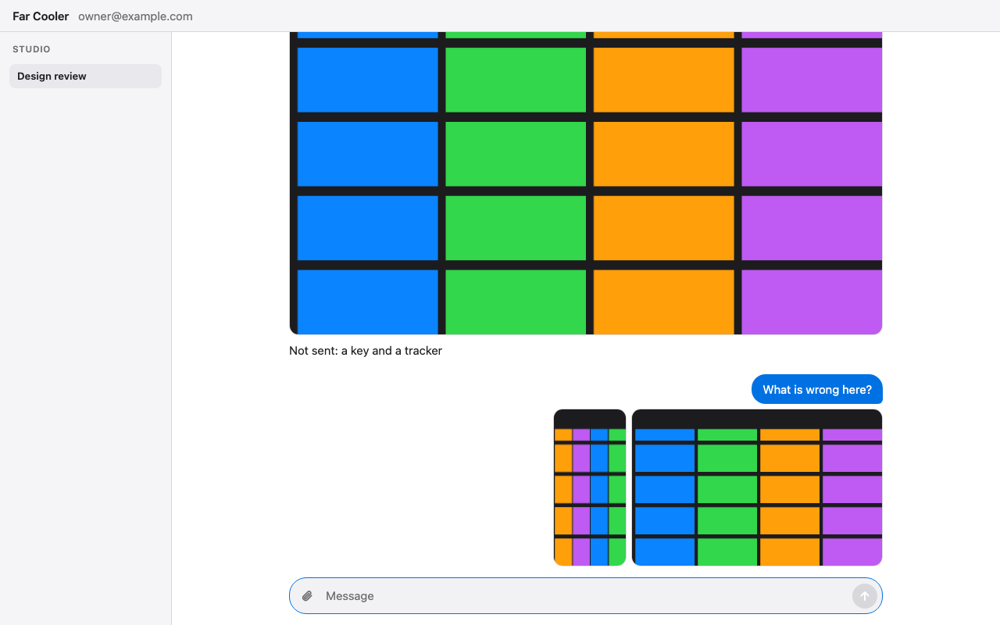

# ov-1509: the web chat shows images and files an agent sends

## What iOS did

iOS never rendered `SendUserFile`: no source on any client named it. The only
images iOS drew in a chat were the ones on a prompt's own turn row
(`Turn.images`), fetched a piece at a time with `agent.image`. The web chat
only said "1 image attached" for those. It now draws both.

## How it works

- **Which files.** The runner's projector (`sent_files.rs`) puts `sent` on a
  `SendUserFile` tool row from the `toolUseResult.attachments` Claude writes
  once the send has succeeded. A failed or unanswered call, another tool with
  the same result shape, and the paths the call asked for add nothing.
- **Bytes.** `agent.file {terminal, row, index, offset, agentId}` (capability
  `agent_files`) over the existing connection. The request has no path.
- **At read time** the path must still resolve where it did when the send was
  folded, to a regular file with one hard link, of the size that was sent.
  Anything else is refused as not found.
- **Markdown.** A reply's `` is drawn only when `dest` is a sent
  image's path, its `file://` form, or the path as the call asked for it
  (percent-encoding aside). The runner decides this (`Prose.images`). Every
  other image, remote ones included, stays alt text.
- **Limits** (in the Rust core): PNG, JPEG, GIF and WebP are drawn, and drawn
  unasked up to 4 MB. A larger one waits behind "Load Image (7.2 MB)". Past
  32 MB there is no download. SVG is a download, never drawn.
- **CSP.** Unchanged. The shell already allows `img-src 'self' data: blob:`.
  Downloads are `application/octet-stream` blobs with a `download` name.

## Limits of the checks

- The runner re-reads transcripts after a restart, so "still resolves where it
  did" is then measured from the restart, not from the send. The size and
  hard-link checks still apply. A file rewritten to the same size is served.
- The row's existing `input` text (what the tool was called with) still shows
  the paths asked for, as every tool row does. `sent` itself carries none.
- A prompt's own images have no recorded size, so they load as they scroll into
  view, with no click-to-load placeholder.
- Claude only. Codex sends nothing this recognizes.
- The Mac and phone apps still show the call as an ordinary tool row.
- The real wasm build was not run here (`wasm-bindgen` is not installed).
  `crates/web` passes `cargo check` for `wasm32-unknown-unknown`, and CI builds
  the module.

## Tests

| Layer | Test |
| --- | --- |
| Projector, path rules, read refusals | `crates/core/.../sent_files_tests.rs` (7) |
| `agent.file` from a real daemon, socket and `--stdio` | `agent_rows_over_every_transport.rs`, `a_sent_file_comes_back_whole_in_pieces_and_nothing_else_does` |
| Browser client over SSH to the fake daemon | `a_sent_files_bytes_come_whole_over_the_connection` |
| The page in headless Chromium with real PNGs | `services/web/test/browser/chat-files-check.mjs` (added to CI) |

`chat-files-check.mjs` was run against the unchanged page first: all four of
its sections failed waiting for an image. Its runner is the scripted
`FakeRunner` in `chat-page.ts`, which stands in for the wasm calls.

## Twenty images

20 PNGs of 1600×1000 (253 KB in all; flat colors, so they compress far better
than real screenshots, while the pixels decoded are the same), 40 ms of fake
delay per fetch, 1280×800, headless Chromium on this Mac:

- Newest image drawn 192 ms after the rows arrived.
- 6 of the 20 fetched while at the bottom; never more than 3 at once.
- A reply streaming below them, change to next frame: median 17 ms, p95 18 ms.
- Scrolling up through all 20: about 1.0 s, each fetched once.
- No long tasks (none over 50 ms).

This does not measure transfer time for large files over a slow link.

## Captures

| 1280 | 320 |
| --- | --- |
|  |  |
|  |  |

